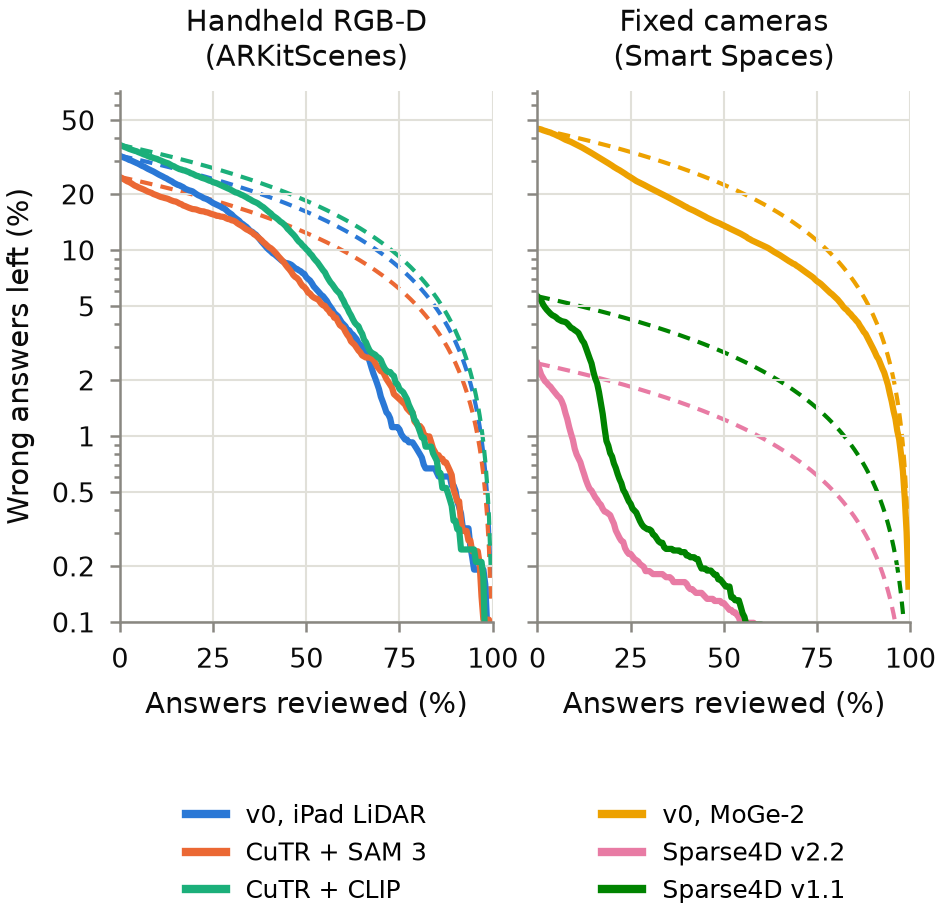

# Measured Space

**Calibrated error bars and certified recall for automatically generated metric 3D labels.**

Licensed under the [PolyForm Noncommercial License 1.0.0](LICENSE): free for personal, hobby, research and
teaching use, not for commercial use. Some files are under other licenses, and several datasets and models it uses
are for non-commercial use only ([License](#license)).

Spatial question–answer data for vision-language models, robot policies and video analytics is increasingly
labelled automatically: a pipeline detects objects, lifts them to 3D boxes, and measures distances and sizes from
those boxes. The pipeline does not know how wrong each measurement is, and it cannot see the objects it missed.
Measured Space is a **research prototype** that audits such labels against independent references. It gives each
metric answer a calibrated error bar, certifies which answers can be accepted without review at a stated error
rate, bounds the share of objects a labeller misses, and measures how much human review that saves. It works on
any labeller's 3D boxes, whether the 3D comes from a depth sensor, monocular depth estimation or several calibrated
cameras.

## What it does



*Reviewing answers in order of predicted risk (solid) reaches a low error rate far sooner than reviewing at random
(dashed). Left: 106 real handheld RGB-D videos; right: 12 synthetic warehouse scenes. Markers: each audit's
certified gate. v0 is the baseline that lifts SAM 3 masks through iPad LiDAR or MoGe-2 monocular depth; CuTR is
Cubify Anything's detector, its boxes named by SAM 3 or CLIP; Sparse4D v2.2 and v1.1 are NVIDIA's current and
pre-2026 checkpoints. Made by `scripts/run_review_effort.py`.*

1. **Paired questions.** Nine metric question types (distances between centres and surfaces, height, longest horizontal side,
   distance from the camera, relative depth, left/right, closest instance, count) are generated once and answered
   twice: from the reference annotations and from a labeller's 3D boxes (`src/measured_space/qa.py`). Labels are
   paired with reference objects by 2D overlap, ignoring class (`matching.py`).
2. **Calibrated error bars.** A per-answer error model (bias, spread, gross-error probability) is cross-fitted
   leaving whole scenes out, and split conformal prediction turns it into 90% intervals whose coverage is checked
   on held-out scenes (`audit.py`).
3. **A certified gate.** Learn-then-Test picks the acceptance threshold so that at most ε of accepted answers are
   wrong at the tolerance, or certifies the yes/no decision an answer supports instead (`decisions.py`).
4. **Missed objects.** Conformal risk control bounds the average per-scene share of objects a detector's candidate
   boxes miss, and disagreement between labellers, frames or cameras flags likely misses without ground truth
   (`recall_control.py`, `misses.py`).
5. **Review effort.** The share of answers a person must check to reach a stated error rate, in order of predicted
   risk against random order (`review_effort.py`).

## Results

Every number below is recomputed from the committed tables in `results/` by [`claims.py`](claims.py) (the id in
the last column); `python claims.py` checks all 192 quantities in about a second, with no data or GPU. Data: 106
ARKitScenes validation videos (2,112 views; iPad RGB and LiDAR; human-annotated 3D boxes as references) and 12
synthetic warehouse scenes from NVIDIA's PhysicalAI-SmartSpaces (D.1). Labellers, all run frozen: a baseline (v0)
that lifts SAM 3 masks through depth (iPad LiDAR on the videos; MoGe-2 monocular depth on the warehouses, "the
monocular baseline"), Cubify Anything (named by SAM 3 or CLIP), and NVIDIA's TAO Sparse4D multi-camera detector
(two checkpoints). A numeric answer is wrong when it misses the reference by more than the tolerance τ (5–10 cm
or 10%, by question type); a categorical answer is wrong unless it matches.

| Finding | Value | Claim |
|---|---|---|
| Handheld metric answers wrong at τ, before gating | 25–33% | A1.1 |
| Held-out 90% intervals that contain the reference value, every labeller | 0.90–0.91 | A4.1 |
| Handheld answers a certified gate accepts at τ (ε = 0.10), and the share of those wrong* | 11–20%, ≤ 7.5% | A4.6 |
| Handheld yes/no decisions certified (ε = 0.05) / wrong among them / wrong if all accepted | 91% / 3.6–4.3% / 6–7% | DEC.1 |
| Older Sparse4D checkpoint: objects missed / answers its feature-model gate accepts at τ, wrong among them | 40% / 92%, 2.7% | A1.7, A4.5 |
| Answers checked to reach ≤ 1% wrong on Sparse4D's labels: risk order / by question type / random | 9% / 18% / 59% | A4.7 |
| Gates whose accepted answers exceed ε on held-out scenes (all audits) / of them on handheld scans | 6 of 45 / 4 | A4.8 |
| Warehouse layout held out: Sparse4D's gate / the monocular baseline's gate (2τ), share wrong | 1.7% / 36% | A4.9 |
| Manual spot check of the pairing: wrong-object pairs, baseline / Cubify | 2 of 97 / 0 of 98 | A3.3, A3.4 |

\* Each labeller's gate uses its feature-model spread, except Cubify + SAM 3 at τ, whose feature-model gate
accepted 14% at 10.3% wrong, over ε; its constant-spread gate is reported instead (A4.5).

## Status and limitations

This is a feasibility prototype, not a finished study:

- **Answers are audited one view at a time**, from that view's boxes (Sparse4D builds its boxes from all cameras
  at once). Fusing boxes over several frames is evaluated but not used: the fused estimates pass a ground-truth-free
  consistency check, yet 76–79% fall outside their 95% error ellipse against the annotated boxes (A2.1).
- **The references are existing annotations**: human-drawn boxes on the iPad's reconstruction, and simulator
  ground truth. No new physical measurements were taken.
- **The certificate treats answers within a scene as independent.** 6 of 45 gates exceeded ε on held-out scenes.
  Four are on the handheld scans, each accepting at most 291 answers; Cubify + SAM 3's feature-model gate at τ is
  one of them. The two that accept the most are on the warehouses (12 scenes built in three layouts): the older
  checkpoint's constant-spread gate (1,921 answers, 15% wrong) and the monocular baseline's gate at 2τ (1,047, 22%).
  Holding a whole layout out breaks it for the weaker labellers (A4.8, A4.9). A scene-level certificate is the
  next step.
- **The warehouse scenes are synthetic**, and the newer Sparse4D checkpoint was trained on the same dataset's 2025
  scenes; Cubify Anything was trained on other captures of ARKitScenes. Their numbers here are likely optimistic.
- **Questions are generated from the reference objects**, so answers about objects a labeller hallucinates are not
  audited yet.
- **The full pipeline (Tier 2 of [`REPRODUCE.md`](REPRODUCE.md)) has not been re-run end to end from scratch**; the
  claims check (Tier 1) has.

## How it's built

Measured Space is built by Claude Code agents, directed by the author. Agents survey the papers and datasets, write
the pipeline and its tests, run the experiments, and review the claims against the results; the author decides
every design fork, judges each result, and makes every merge. `claims.py` exists so that every reported number can
be checked against the committed tables without trusting anyone's summary.

## Quick start: check the claims

```bash
./setup_env.sh claims        # a light conda env (no PyTorch, no data); refuses if "measured-space-claims" exists
conda activate measured-space-claims
python claims.py             # every claim: stated value, recomputed value, PASS / FAIL
```

## Layout

| Path | What |
|---|---|
| `src/measured_space/` | The package: question generation, pairing, the audit, decisions, misses, recall control, review effort, dataset loaders |
| `scripts/` | Command-line entry points: a `run_*.py` per stage, plus data checks, the Sparse4D tools and the viewer; each docstring says what it reads and writes |
| `tests/` | Unit tests (`pytest`); tests that need the datasets or a GPU skip without them |
| `results/` | Committed aggregate tables and figures, read by `claims.py` |
| `configs/` | Data-path template, warehouse camera selection, warehouse layout groups |
| `envs/sparse4d/` | The separate environment for NVIDIA's Sparse4D detector |
| `docs/DATASETS.md` | Datasets used and considered, their licenses, download sizes and folder layout |
| `REPRODUCE.md` | Checking the claims (Tier 1) and regenerating every table from raw data (Tier 2) |

## Setup

```bash
./setup_env.sh full                  # the environment the results were produced with (PyTorch 2.14.1, CUDA 13.0)
conda activate measured-space
cp configs/paths.example.yaml configs/paths.local.yaml   # then set the data folders (git-ignored)
python -m pytest -q
```

Datasets and model weights live outside the repository and are never committed. [`REPRODUCE.md`](REPRODUCE.md)
lists what to download, the separate Cubify Anything and Sparse4D environments, and the command for each stage.

## License

Measured Space is licensed under the [PolyForm Noncommercial License 1.0.0](LICENSE). Code taken from other
projects keeps its own license: [THIRD_PARTY_NOTICES.md](THIRD_PARTY_NOTICES.md) lists every such file, and
`LICENSES/` holds the license texts.

The datasets and model weights you download have their own terms, which you accept by using them; several are for
**non-commercial or research use only**. `THIRD_PARTY_NOTICES.md` lists them, and `docs/DATASETS.md` gives the
details. The warehouse results derive from NVIDIA PhysicalAI-SmartSpaces, licensed under CC BY 4.0.
